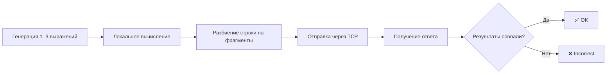

# TCP-клиент-верификатор

Клиент создаёт несколько TCP-соединений с сервером, генерирует случайные арифметические выражения и проверяет ответы с помощью локального вычисления.



## Как работает клиент

Для каждого соединения клиент:

1. Генерирует от одного до трёх выражений, содержащих заданное количество чисел от 1 до 100.
2. Вычисляет ожидаемые результаты локально с учётом приоритета `*` и `/`.
3. Делит строку на случайные фрагменты и последовательно отправляет их в один сокет.
4. Добавляет перевод строки как маркер конца запроса.
5. Получает строку результатов от сервера и сравнивает значения с погрешностью `10⁻³`.

Все сокеты переведены в неблокирующий режим и обслуживаются одним экземпляром `epoll`.

## Требования

- Linux;
- компилятор с поддержкой C++23;
- CMake 3.31 или новее;
- запущенный [сервер проекта](../Server/README.md).

## Сборка

Из корня репозитория:

```bash
cmake -S . -B build
cmake --build build --target Client
```

## Запуск

```bash
./build/Client/Client <numbers> <connections> <server_addr> <server_port>
```

Параметры:

| Параметр | Значение |
| --- | --- |
| `numbers` | количество чисел в каждом выражении |
| `connections` | количество параллельных соединений и запросов |
| `server_addr` | IPv4-адрес сервера, например `127.0.0.1` |
| `server_port` | TCP-порт сервера |

Пример:

```bash
./build/Client/Client 6 3 127.0.0.1 8080
```

## Формат вывода

Успешная проверка:

```text
✅ OK: 6+80+80*21*16+3 98+37+73*49/33*51
```

Несовпадение:

```text
❌ Incorrect
Sent:     69/91-93/61*44+4 47+16-17+77*36+18
Expected: -62.3237 2836
Received: -8.241758
```

## Ограничения

- адрес сервера разбирается функцией `inet_pton`, поэтому нужно передавать IPv4-адрес, а не доменное имя;
- выражения не поддерживают скобки и унарные операторы;
- генератор использует числа от 1 до 100, поэтому в автоматически созданных выражениях нет деления на ноль;
- клиент ожидает один ответ на каждое соединение и после проверки закрывает сокет.

Вернуться к [общему описанию проекта](../README.md).
