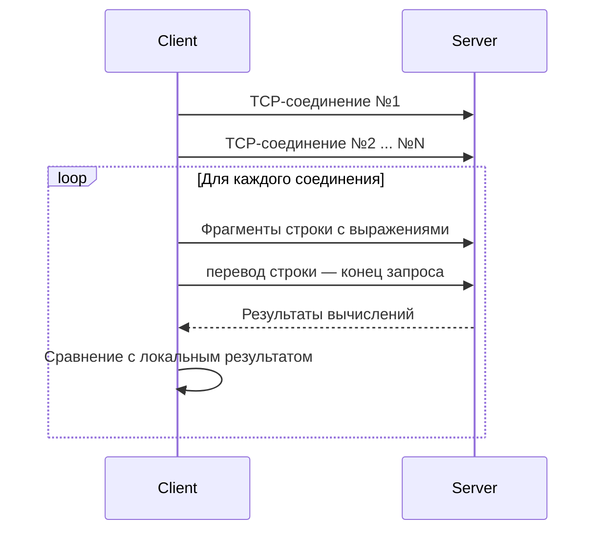

# TCP-калькулятор и клиент-верификатор

Учебный клиент-серверный проект на C++ для знакомства с TCP, неблокирующими сокетами и событийной моделью Linux `epoll`. Сервер вычисляет арифметические выражения, а клиент создаёт несколько параллельных соединений, отправляет выражения фрагментами и проверяет полученные результаты.



## Возможности

- одновременная работа с несколькими TCP-соединениями;
- неблокирующий ввод-вывод через `epoll`;
- намеренное разбиение запроса на случайные фрагменты для проверки потоковой природы TCP;
- от одного до трёх выражений в одном запросе;
- операции `+`, `-`, `*`, `/` с учётом приоритета умножения и деления;
- автоматическая проверка ответа сервера на стороне клиента.

## Структура проекта

| Каталог | Назначение | Документация |
| --- | --- | --- |
| `Server` | TCP-сервер, принимающий выражения и возвращающий результаты | [README сервера](Server/README.md) |
| `Client` | Генератор запросов и верификатор ответов | [README клиента](Client/README.md) |

## Требования

- Linux: проект использует `epoll`, POSIX-сокеты и заголовок `unistd.h`;
- компилятор с поддержкой C++23;
- CMake 3.31 или новее.

## Сборка

Из корня репозитория выполните:

```bash
cmake -S . -B build
cmake --build build
```

После сборки исполняемые файлы находятся в `build/Server/Server` и `build/Client/Client`.

## Запуск

Сначала запустите сервер, указав свободный TCP-порт:

```bash
./build/Server/Server 8080
```

Во втором терминале запустите клиент:

```bash
./build/Client/Client 6 3 127.0.0.1 8080
```

Аргументы клиента:

| Аргумент | Описание |
| --- | --- |
| `6` | количество чисел в каждом выражении |
| `3` | количество параллельных TCP-соединений |
| `127.0.0.1` | IPv4-адрес сервера |
| `8080` | порт сервера |

При успешной проверке клиент выводит отправленную строку:

```text
✅ OK: 58/96/71/62*19/82
✅ OK: 79-77+29/67*35-27 52+46/12+57/67/53 80+52*95-8*35-64
```

Если ответ отличается от локально вычисленного результата, выводятся запрос, ожидаемые значения и ответ сервера:

```text
❌ Incorrect
Sent:     24/75*16*59*91+8
Expected: 27497.3
Received: 24.000000
```

## Протокол обмена

Клиент формирует строку из одного или нескольких выражений. Выражения разделяются пробелом, а запрос завершается символом новой строки:

```text
2+2*3 100/4-5
```

Ответ содержит результаты в том же порядке и также завершается переводом строки:

```text
8.000000 20.000000
```

## Текущее ограничение

Клиент специально разбивает запрос на части, однако сервер сейчас начинает вычисление после каждого события чтения, не дожидаясь конца строки. Поскольку TCP не сохраняет границы отправленных фрагментов, один запрос может быть обработан частично. Это объясняет возможный вывод `Incorrect` и служит основной точкой для дальнейшего улучшения проекта: накапливать данные в `recv_buffer` и обрабатывать только полные строки.

## Лицензия

Учебный проект. Отдельный файл лицензии в репозитории не указан.
