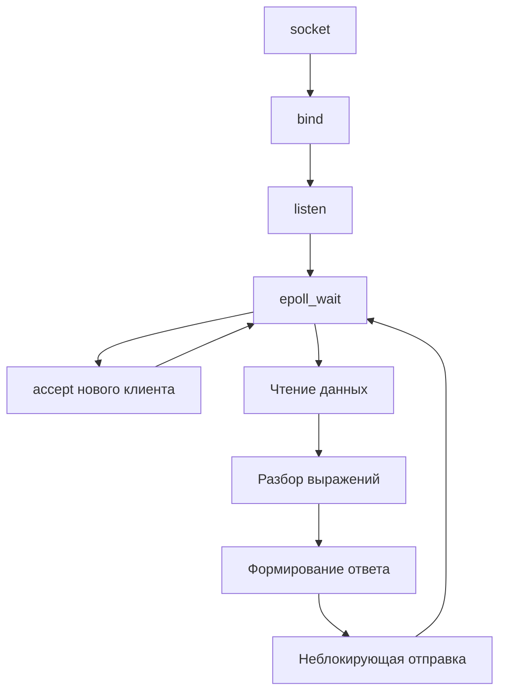

# TCP-сервер-калькулятор

Сервер принимает арифметические выражения по TCP, вычисляет их и отправляет клиенту результаты. Несколько подключений обслуживаются в одном цикле событий Linux `epoll`.



## Возможности

- приём нескольких клиентских подключений;
- неблокирующие сокеты;
- мультиплексирование событий через `epoll`;
- отдельные буферы приёма и отправки для каждого клиента;
- вычисление операций `+`, `-`, `*`, `/`;
- выполнение умножения и деления раньше сложения и вычитания;
- обработка нескольких выражений, разделённых пробелами.

## Требования

- Linux;
- компилятор с поддержкой C++23;
- CMake 3.31 или новее.

## Сборка

Из корня репозитория:

```bash
cmake -S . -B build
cmake --build build --target Server
```

## Запуск

```bash
./build/Server/Server <port>
```

Например:

```bash
./build/Server/Server 8080
```

Сервер привязывается ко всем локальным интерфейсам (`INADDR_ANY`) и выводит сообщение:

```text
Server started on port 8080
```

## Формат данных

Запрос содержит одно или несколько выражений без пробелов внутри каждого выражения. Между выражениями ставится пробел:

```text
2+2*3 100/4-5
```

Ответ содержит результаты с шестью знаками после десятичной точки:

```text
8.000000 20.000000
```

## Разбор выражений

Парсер выполняет вычисление в два прохода:

1. Последовательно сворачивает операции `*` и `/`.
2. Выполняет оставшиеся операции `+` и `-` слева направо.

Скобки, степени и функции не поддерживаются.

## Текущее ограничение TCP-буферизации

В текущей реализации сервер вычисляет содержимое `recv_buffer` сразу после успешного `read`. TCP может объединять несколько отправок или возвращать только часть строки, поэтому граница одного чтения не равна границе запроса. Для надёжной обработки фрагментированных сообщений серверу следует искать перевод строки в буфере и вычислять только полностью полученные строки.

Вернуться к [общему описанию проекта](../README.md).
